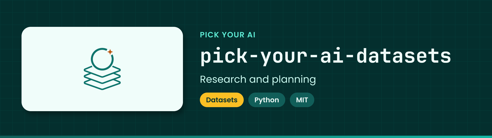

<!-- showcase:banner:start -->
<p align="center">
  
</p>
<!-- showcase:banner:end -->

<!-- showcase:nav:start -->
**Pick Your AI** · [All repositories](https://github.com/Pick-Your-AI) · [Docs](docs/) · [Contributing](CONTRIBUTING.md) · [Security](SECURITY.md)
<!-- showcase:nav:end -->

<div align="center">

# Pick Your AI — Datasets & Benchmark Research

<!-- showcase:badges:start -->


<!-- showcase:badges:end -->

<!-- showcase:tagline:start -->
**Research and planning for an evidence-backed directory of AI datasets and benchmarks: identity, versions, rights, provenance and evaluation integrity.**
<!-- showcase:tagline:end -->

</div>

---

## About

This repository plans and researches an evidence-backed directory of AI datasets and benchmarks. It records each dataset's identity, versions, rights, provenance and evaluation integrity, and it hands accepted records to other Pick Your AI repositories. It stores **metadata, evidence pointers and checksums only — never dataset contents**.

| Resource | Link |
| --- | --- |
| Project | [Pick Your AI — Datasets & Benchmark Research (#11)](https://github.com/orgs/Pick-Your-AI/projects/11) |
| Program issue | [#1 `DATA` program](https://github.com/Pick-Your-AI/pick-your-ai-datasets/issues/1) (native child of [research #509](https://github.com/Pick-Your-AI/pick-your-ai-research/issues/509)); stable ID map in [planning/issue-map.json](planning/issue-map.json) |
| Delivery plan | [docs/DELIVERY_PLAN.md](docs/DELIVERY_PLAN.md) (generated) |
| Charter and scope | [docs/charter.md](docs/charter.md) |
| Organization policy | [Pick-Your-AI/.github CONTRIBUTING.md](https://github.com/Pick-Your-AI/.github/blob/main/CONTRIBUTING.md) |

## Notes

### Status

This is the **foundation**. The repository, Project, issue hierarchy, governance and validators are established. **No dataset or benchmark record has been researched, accepted or published yet.** Every work package starts in Backlog, and the research itself begins after this foundation is accepted.

### Layout

| Path | Contents |
| --- | --- |
| `planning/` | Canonical backlog, coverage ledger, decision register, release manifest, issue map and generated issue bodies |
| `schemas/` | JSON schemas for planning files and draft dataset/benchmark proposal records |
| `catalog/proposals/` | Real dataset and benchmark proposal records (empty until research begins) |
| `evidence/`, `research/` | Evidence manifests and research notes, as metadata and Markdown only |
| `examples/` | Explicitly synthetic example records |
| `templates/` | Proposal and acceptance templates |
| `scripts/` | Validators and the documentation renderer |
| `tests/` | Regression tests |

### Validate

Run from the repository root with Python 3.12 or later. Nothing else needs installing:

```bash
python3 scripts/validate_plan.py
python3 scripts/validate_catalog.py
python3 scripts/render_docs.py --check
python3 -m unittest discover -s tests -v
```

`python3 scripts/validate_plan.py --live` also reads GitHub through an authenticated `gh` CLI and reports drift between the plan and the actual issues, parents, blockers and Project items. It never writes.

Licensed under the [MIT License](LICENSE). The license covers this repository's own files. It grants no rights over any dataset described here.

## License

Code and documentation are licensed under the MIT License; see `LICENSE`. Pick Your AI names and logos are reserved and are not licensed for reuse except to identify this project.
